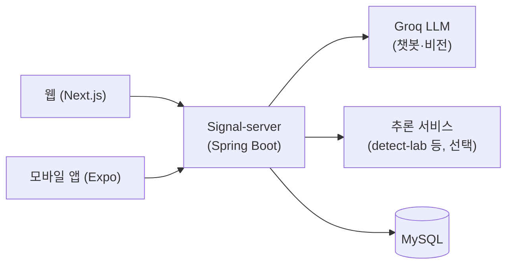

# NAVER OGQ PROJECT

<h2>Signal</h2>

> **당신이 보낸 구조 신호, Signal이 안전한 일상으로 답합니다.**

Signal은 AI 기반 온라인 안전 서비스입니다. 디지털 성범죄, 딥페이크, 얼굴 도용 같은 온라인 위험이 늘어나는 상황에서, 피해를 겪는 사람이 혼자 방법을 찾아 헤매지 않도록 예방부터 대응까지 한 곳에서 지원합니다. 이 저장소는 Signal의 웹(Next.js)과 모바일 앱(Expo) 클라이언트입니다.

웹에서는 로그인 없이도 위험도 분석, 탐지, 상담을 체험할 수 있고, 모바일 앱은 같은 기능을 휴대폰 화면으로 제공합니다. 앱은 대회 시연용이며 스토어에 배포하지 않습니다.

[웹 체험하기](https://signal-web-rho.vercel.app) · 백엔드는 [Signal-server](https://github.com/somaus/Signal-server)에 있습니다. 팀 소마어스가 개발합니다.

<h3>핵심 기능</h3> <hr>

* **AI 이미지 위험도 분석과 보호**: 사진을 올리기 전에 이미지 품질, 얼굴 노출도, 메타데이터(위치 등) 노출, 웹 노출 가능성을 AI가 먼저 확인합니다. 필요하면 노이즈 삽입과 메타데이터 제거로 보호 처리합니다.
* **딥페이크 탐지**: 사진에서 합성 흔적을 탐지합니다. 기본은 비전 LLM이고, 서버 설정으로 전용 탐지 모델(CommunityForensics)로 바꿀 수 있습니다. 결과는 점수 대신 "합성 흔적을 찾지 못함" 같은 등급과 "판단 불가"로 보여 주고, 이미지를 단정하지 않습니다.
* **유포 모니터링**: 기준 이미지를 등록해 두면 웹에서 유사 이미지가 다시 퍼지는지 추적하는 기능입니다. 현재는 시연용 스텁 단계입니다.
* **익명 상담 챗봇**: 신원을 밝히지 않고 AI 상담사와 현재 상황을 상담하고, 맞춤형 대응 방법을 안내받습니다. 위기 감지와 기관 추천은 AI가 아니라 서버의 규칙이 정합니다.
* **신고 지원과 기관 연계**: 피해 상황을 바탕으로 기관 제출용 신고 문서(PDF) 초안을 만들고, 상황에 맞는 전문 지원 기관으로 바로 연결합니다.
* **다국어와 비로그인 체험**: 한국어, English, 日本語, 简体中文을 지원합니다. 영어·일본어·중국어 번역은 원어민 검수 전입니다. 비로그인 이용은 서버가 IP 기준으로 횟수를 제한합니다.

<h3>아키텍처</h3> <hr>

웹과 앱은 화면과 사용자 입력을 맡고, 분석과 판단은 모두 Signal-server가 처리합니다. 서버는 LLM(Groq)과 전용 추론 서비스를 호출하고, 안전과 정확성이 중요한 부분(위기 감지, 기관 추천, 메타데이터 판독)은 규칙 기반으로 직접 처리합니다.



API 키가 없거나 호출이 실패하면 서버가 룰 기반 응답으로 대체하고, 이때 화면에 참고용 추정치임을 안내합니다.

<h3>기술 스택</h3> <hr>

| 영역 | 구성 |
| :--- | :--- |
| **Web** | Next.js 16 (App Router), React 19, TypeScript, Tailwind CSS v4 |
| **Mobile** | React Native (Expo), `mobile/` 폴더 |
| **데이터 페칭** | TanStack Query, Axios |
| **Design** | Figma |
| **IDE / Tool** | VS Code, Claude Code CLI, GitHub |

<h3>빠른 실행</h3> <hr>

**웹**

```bash
# 1. 저장소 복제
git clone https://github.com/somaus/Signal-web.git
cd Signal-web

# 2. 패키지 의존성 설치
npm install

# 3. 환경 변수 설정 (.env.example을 복사한 뒤 NEXT_PUBLIC_API_BASE_URL에 백엔드 API 서버 주소 입력)
cp .env.example .env.local

# 4. 개발 서버 실행
npm run dev
```

**모바일 앱**

Expo Go로 실행하는 것이 기본이고, Expo Go를 쓸 수 없는 Android 기기에서는 시연용 APK를 씁니다. 실행 방법과 환경변수, APK 빌드는 [mobile/README.md](mobile/README.md)에 있습니다.

```bash
cd mobile
npm install
npx expo start
```

<h3>프로젝트 구조</h3> <hr>

Feature-Sliced Design(FSD)을 지향하는 구조로, 레이어 간 참조 방향을 `app → views → widgets → features → entities → shared` 한 방향으로만 유지합니다.

```
src/
├── app/        # Next.js 라우팅 (페이지, 레이아웃)
├── views/      # 페이지 단위 화면 (홈, 분석, 신고, 채팅, 마이페이지 등)
├── widgets/    # 여러 화면에서 재사용되는 레이아웃 블록 (헤더, 푸터 등)
├── features/   # 사용자 동작 단위 기능
├── entities/   # 도메인 API 클라이언트 및 데이터 매핑 (report, analysis, agency, monitoring, chat, user)
└── shared/     # 공용 axios 인스턴스, 쿼리 클라이언트, UI 킷, 아이콘, 다국어(i18n), 유틸

mobile/         # Expo 모바일 앱 (웹과 별도로 실행·빌드)
```

<h3>공개 원칙</h3> <hr>

프로젝트에 사용한 AI 모델, 오픈소스, 외부 자문 내역을 아래와 같이 공개합니다.

**서비스에 사용한 AI 모델** (백엔드 [Signal-server](https://github.com/somaus/Signal-server)에서 [Groq](https://console.groq.com) API로 호출)

| 기능 | 모델 | 비고 |
| :--- | :--- | :--- |
| 익명 상담 챗봇 | `openai/gpt-oss-120b` | 일반 대화 답변만 LLM 생성, 위기 감지·추천 행동/기관은 룰 기반 |
| AI 이미지 위험도 분석 | `qwen/qwen3.8-27b` (비전 LLM) | 메타데이터 노출은 EXIF 직접 판독. 서버 설정으로 이미지에서 직접 잰 값(얼굴 크기·선명도·정면도)을 쓰는 방식도 선택 가능 |
| 딥페이크 탐지 | `qwen/qwen3.8-27b` (비전 LLM, 기본) | 범용 비전 언어 모델이라 전문 탐지 모델이 아님. 서버 설정(`deepfake-detection.mode=http`)으로 CommunityForensics ViT-S 전용 모델로 전환 가능. 이미지만 지원 |

API 키 미설정 또는 호출 실패 시에는 룰 기반 응답으로 대체되며, 이 경우 화면에 참고용 추정치임을 안내합니다.

**기능별 한계**

| 기능 | 현재 동작 |
| :--- | :--- |
| 이미지 보호 처리 | 서버가 이미지에 픽셀 노이즈를 삽입하고 PNG로 다시 저장해 EXIF(GPS 등 메타데이터)를 제거. 특정 AI 모델을 겨냥한 적대적 노이즈(adversarial perturbation)는 아니라서 도용·합성 방지를 보장하지 않음 |
| 유포 모니터링 (얼굴 도용 추적) | **기본은 시연용 스텁.** 실제 웹 검색 없이 서버가 예시 탐지 결과(0~3건)를 생성. 서버에 검색 방식이 구현돼 있지만 설정을 켜야 동작하며, 썸네일은 샘플 이미지이고 원본 링크는 제공하지 않음 |
| 딥페이크 탐지 정확도 | 전용 모델을 공개 데이터 164장으로 잰 값이며 한국 SNS 사진이나 실제 피해 사진 기준이 아님. 압축된 가짜 이미지는 절반 가까이 "가짜 아님"으로 넘어감(미탐률 메신저 48.8%, JPEG70 53.6%). 그래서 낮은 위험 등급은 "진짜"가 아니라 "합성 흔적을 찾지 못함"으로 표시. 측정 문서는 Signal-server의 `docs/detect-eval-results.md` |
| 번역 | 영어·일본어·중국어(간체) 번역은 원어민 검수 전. 번체 중국어 요청은 한국어로 처리 |
| 모바일 앱 | 시연용(Expo Go, APK). 스토어 배포 없음 |

이미지 보호와 유포 모니터링은 화면에서 위 한계를 안내하고 있습니다.

**개발에 사용한 AI 도구**

| 도구 | 용도 |
| :--- | :--- |
| Claude Code (Anthropic Claude Opus 5.5, Claude Sonnet 5) | 코드 작성 보조, 리팩터링, 빌드 오류 수정 |

**사용한 오픈소스**

| 라이브러리 | 버전 | 라이선스 |
| :--- | :--- | :--- |
| Next.js | 16.2.4 | MIT |
| React / React DOM | 19.2.4 | MIT |
| TypeScript | 5.9.3 | Apache-2.0 |
| Tailwind CSS | 4.2.4 | MIT |
| TanStack Query | 5.100.9 | MIT |
| Axios | 1.16.0 | MIT |
| Sonner | 2.0.7 | MIT |
| ESLint | 9.39.4 | MIT |
| Prettier | 3.8.3 | MIT |
| Pretendard (폰트) | 1.3.9 | SIL Open Font License 1.1 |

모바일 앱(`mobile/`)의 의존성은 `mobile/package.json`을 참고하세요.

**외부 자문**

- 외부 자문 없음
